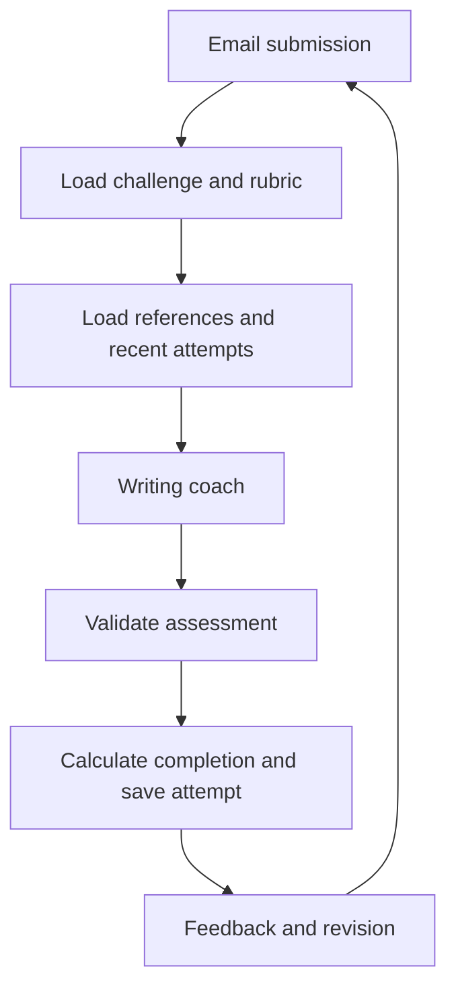

# Rookit writing-coach agent

Runnable Python backend for the English mock dataset. One controlled workflow loads a challenge, rubric and references, evaluates an email, validates the feedback, records the attempt, and compares later revisions. Learners write in English; question text and live AI feedback are in Korean.

## Structure

| File | Responsibility |
|---|---|
| `rookit/api.py` | FastAPI routes and anonymous session access |
| `rookit/agent.py` | Coach workflow, feedback validation, completion, revision comparison |
| `rookit/providers.py` | OpenAI structured output and offline fixture replay |
| `rookit/prompts.py` | Writing-coach instructions |
| `rookit/schemas.py` | Submission and assessment contracts |
| `rookit/data.py` | Exact-ID access to challenges, private answer keys and references |
| `rookit/storage.py` | SQLite sessions and attempt history |
| `rookit/evaluate.py` | Development evaluation runner |
| `data/mock-data-english/` | Original seven-file English mock dataset |
| `tests/test_coach.py` | API, completion, isolation, revision and provider contract tests |



The backend chooses the tools in a fixed order. No autonomous tool loop or vector database is required. `get_challenge`, `get_answer_key`, `get_references`, and `Store.history` supply the model context. Hints come directly from the reviewed-in-future dataset rather than using a paid model call.

## Run locally

Python 3.11 or newer. Run from this folder:

```sh
python3 -m venv .venv
source .venv/bin/activate
pip install -r requirements-dev.txt
export ROOKIT_MODE=replay
uvicorn rookit.api:create_app --factory --host 127.0.0.1 --port 8000
```

Open http://127.0.0.1:8000/docs for the interactive API. Replay mode has no model calls. It accepts only exact subject/body pairs from `evaluation_cases.json`, returns deterministic fixture feedback, and labels responses `mode: replay`. It cannot assess arbitrary writing; even a changed punctuation mark may be rejected. Replay scores and whole-body evidence are placeholders for integration testing.

To evaluate real writing, restart with:

```sh
export ROOKIT_MODE=live
export OPENAI_API_KEY='your-key'
export OPENAI_MODEL='a-structured-output-capable-model-you-can-access'
uvicorn rookit.api:create_app --factory --host 127.0.0.1 --port 8000
```

`.env.example` documents configuration; `.env` is not loaded automatically. Never put the API key in frontend code. Live mode sends the challenge, rubric, reference guidance, current answer and up to three prior attempts to OpenAI. Requests use `store=False`; that is not a guarantee of zero provider retention. No live call was run during setup.

## Frontend integration

1. `POST /sessions` returns an opaque bearer token. Keep it private; it grants access to that session's attempts.
2. `GET /challenges` lists all 300 English challenges. The optional `language` parameter accepts only `en`.
3. `GET /challenges/{id}` returns the learner-facing problem, and `GET /challenges/{id}/hint` returns its hint.
4. `POST /challenges/{id}/attempts` with `Authorization: Bearer TOKEN` and JSON `{"subject":"...","body":"..."}` returns `{attempt_id, feedback}`.
5. Submit a revision to the same route with the same token. `feedback.revision` lists resolved and regressed requirement IDs.
6. `GET /challenges/{id}/attempts` with the token returns the latest 20 attempts in chronological order.

Use `en_001_compose` for the first exercise. In `/docs`, create a session, click Authorize, paste the token, then submit an exact evaluation-case answer for replay mode. Answer keys and sample answers are server-side; there is no endpoint exposing them. Do not serve the data directory as static frontend assets.

Feedback includes individual requirement checks, exact supporting excerpts, weighted scores, issues, contradictions, reference IDs, completion and revision changes. The total and completion are computed by Python, not accepted from the model. Completion requires at least 75 points, every critical requirement satisfied, and no reported contradictory facts. Missing/duplicate requirement IDs, invented quotations, unknown references or missing revision guidance fail validation and are not saved. Semantic correctness still depends on the model and needs evaluation.

Unknown challenges return 404; invalid/blank submissions return 422; missing sessions return 401; provider configuration/failure or unknown replay inputs return 503; invalid model assessments return 502. Failed attempts are not recorded. Successful submissions are stored in `runtime/attempts.sqlite3`; override with `ROOKIT_DB_PATH`. Requests are not idempotent: repeated successful submissions create separate attempts.

## Checks and evaluation

```sh
python -m pytest -q
python -m rookit.evaluate --mode replay
# Optional: 600 paid model requests, uses your configured OpenAI credentials.
python -m rookit.evaluate --mode live > evaluation-results.json
```

Fixture expectations are never sent to the live model. The runner measures completion and unmet-requirement agreement. Review explanation accuracy, usefulness and answer leakage manually. The dataset reuses sample answers and related scenarios, so these checks are development tests rather than independent evidence of educational quality.

## MVP boundaries

Anonymous bearer sessions provide basic isolation, not production account authentication. Sessions have no expiration or recovery; losing a token loses access. Run on localhost for the demo. Add account authentication, token expiry, HTTPS, rate limits and a retention policy before public deployment. There is no CORS middleware by default; use a same-origin backend proxy or explicitly configure your frontend origin. Submit sequentially per learner/challenge so revision comparisons use the latest completed attempt.

When English is selected on the learning kits page, the Next.js web app loads these challenges for stages 1 and 2 and proxies submissions through `/api/agent/evaluations`. Stage 0 keeps its local blank-answer grader. Human review of the mock curriculum and live grading evaluation remain necessary.

OpenAI structured-output integration reference: https://developers.openai.com/api/docs/guides/structured-outputs

## Run with the web app

From the repository root, run `docker compose up -d --build`. This starts PostgreSQL,
web, the Korean `ai` service and the agent (replay mode by default). The web server uses
`AGENT_API_BASE_URL=http://agent:8000`; local development uses
`AGENT_API_BASE_URL=http://localhost:8001` (host port 8001, no `/api/v1` prefix).
The agent's SQLite history is retained in `rookit-agent/runtime`.

For real writing, create `rookit-agent/.env` with `ROOKIT_MODE=live`,
`OPENAI_API_KEY`, and `OPENAI_MODEL`, then run `docker compose up -d --force-recreate agent`.
Docker loads this file; standalone uvicorn still requires exported variables.
Never commit credentials. Replay mode only accepts exact evaluation-case answers.
The UI reports this limitation and never silently substitutes demo grading.

Agent bearer sessions are held in signed, HttpOnly cookies bound to the web user.
Revisions in the same login/browser reuse the session; logout clears it.
Browser history remains local; the agent also stores successful attempts in SQLite.
Run `pnpm test:agent` in `web` for adapter and session-isolation checks.
